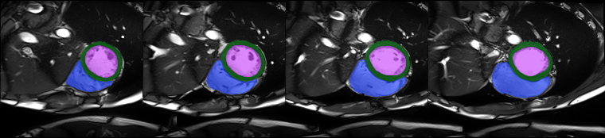

## Background
### TigerHx: Tissue Mask Generation for Heart
* This repo provides deep learning methods with pretrained models for cardiac cine MRI segmentation.
* We also provided the stand-alone application working on Windows, Mac, and Linux.
* The software has been exclusively designed for research purposes and is not intended for any commercial application.
* The software should not be used in clinical applications.

### Install stand-alone version
    https://github.com/htylab/tigerhx/releases
### Install package
    pip install onnxruntime #for gpu version: onnxruntime-gpu
    pip install https://github.com/htylab/tigerhx/archive/main.zip
    
## Usage
    import tigerhx
    tigerhx.run('', r'C:\sample\cine4d.nii.gz', r'c:\temp') #Segmentation only
    tigerhx.run('r', r'C:\sample\cine4d.nii.gz', r'c:\temp')
    tigerhx.run('rg', r'C:\sample\cine4d.nii.gz', r'c:\temp') # with GPU

### As a command line tool:

    tigerhx c:\data\*.nii.gz -o c:\output
    tigerhx c:\data -o c:\output -g --model cine4d_v0006_xy_cine.onnx

## GUI

    pip install "tigerhx[gui] @ https://github.com/htylab/tigerhx/archive/main.zip"
    tigerhx-gui                      # or: python -m tigerhx.webgui.app

The GUI runs a local server (127.0.0.1 only) and shows the page in a native
window when `pywebview` is installed, otherwise in the default browser
(`--browser` forces the browser). Results and the case list are kept in a
workspace folder, `~/TigerHx` by default (`-w <folder>` to change).

Workflow:

1. **＋ Files / ＋ Folder** – add cine NIfTI files; folders are searched
   recursively with optional include / exclude keywords. No CSV is needed.
2. **▶ Segment** – runs the selected model on all pending (or the checked)
   cases. Models are downloaded on first use.
3. **Review** – the viewer (NiiVue) shows the image with the segmentation,
   its contours or the AHA 17-segment overlay, single slice or all slices,
   zoomed to the heart (the previous GUI's `_crop` views) or the full image,
   with a frame slider and ED/ES jump. Overlays are drawn as smooth outlines
   rather than voxel blocks; AHA segments are numbered and coloured by wall,
   so a wall keeps its colour at every level.
   The first apical slice and the slice order (base→apex or apex→base) are
   suggested automatically; check them on the images and use
   *Use current slice as apex* or *Confirm suggestion*. The AHA labels are
   recomputed instantly.
4. **Segmentation check** (right panel) – slices whose segmentation is worth
   a look: a cavity larger at ES than at ED (often a structure outside the
   ventricle), a cavity missing between two slices that have it, and a
   basal-most LV at ES that is poorly enclosed by myocardium (the LV label
   probably covers atrium). *Show* jumps to the frame and slice; the case
   list shows the number of warnings (⚠) or ✓.

Files written per case in `<workspace>/cases/<name>/`: `seg.nii.gz`
(labels 1–3), `aha17.nii.gz` (AHA segments 1–17 on the myocardium) and,
unless switched off under *Settings*, the `.mat` file of the previous GUI
(`*_pred_<version>.mat`, same fields plus `AHA17`).

Notes:

* The GUI does not report volumes or EF. ED and ES (largest and smallest LV
  blood volume, as in the previous GUI) are only used for the checks, the
  AHA analysis and the `.mat` fields.
* The checks use areas in mm² from the NIfTI voxel size, so they behave the
  same at any resolution. They only catch clear errors; stepping through the
  slices with *Contours* is still the real check.
* AHA sectors use the direction from the LV to the RV blood-pool centroid as
  reference (septum between sectors 2 and 3), as in the previous GUI; the
  segment names assume the standard short-axis orientation. Slices from the
  base to the apical start are split evenly into basal and mid; slices with
  myocardium but no cavity beyond it are segment 17.

The previous Tk GUI (`tigercinegui.py`) is still available.

## Validation

`tools/eval_acdc.py` downloads a preprocessed copy of ACDC from Hugging Face
(`mathpluscode/ACDC`, CC BY-NC-SA 4.0, resampled to 1 × 1 × 10 mm and cropped
around the LV) and compares models with the expert ED/ES labels:

    python tools/eval_acdc.py --per-group 2 --models cine4d_v0006_xy_cine.onnx
    python tools/eval_acdc.py --per-group 4 --ed-rule first_frame --out acdc.csv

It reports Dice per structure, LV/RV EF error, EDV and mass error and whether
the detected ED/ES frames match the labelled ones; volumes and EF are
computed here only, as a measure of segmentation quality. ES is the frame with
the smallest LV volume, ED the largest (`--ed-rule first_frame` for frame 0);
LV mass = myocardium volume at ED × 1.05 g/mL. By default, slices whose cavity
at ES is more than twice its ED area plus 200 mm² are left out
(`--no-auto-exclude` counts every slice). On 15 ACDC cases (v0006, labelled
ED/ES frames) this lowered the LV EF mean absolute error from 4.1 to 3.1
points (worst case 21.5 → 8.4); hole filling and optical-flow temporal voting
did not help. Models trained on ACDC (e.g. v0003 *mms12acdc*) score
optimistically on it.

## Development

    pip install -e . onnxruntime onnx pytest
    pytest tests

`tigerhx/core` holds the UI-independent code shared by the CLI and both GUIs
(inference, AHA, metrics, file I/O, workspace). The tests use a synthetic
phantom and a tiny ONNX model, so they need no network or real data.

The Windows executables are built by `.github/workflows/gui-app.yml`. The
web GUI build leaves out modules it does not use (most of SciPy, matplotlib,
Pillow, Tcl/Tk), and `tools/smoke_exe.py` then runs the built `.exe` on a
synthetic case, so a module that is needed but left out fails the build.

# Label names:

## cine4d
| Label No. | Structure Name            |
| --------- | ------------------------- |
| 1         | Left Ventricle blood      |
| 2         | Left Ventricle Myocardium |
| 3         | Right Ventricle blood     |

## Disclaimer

The software has been exclusively designed for research purposes and has not undergone review or approval by the Food and Drug Administration or any other agency. By using this software, you acknowledge and agree that it is not recommended nor advised for clinical applications.  You also agree to use, reproduce, create derivative works of, display, and distribute the software in compliance with all applicable governmental laws, regulations, and orders, including but not limited to those related to export and import control.

The software is provided "as is", without warranty of any kind, express or implied, including but not limited to the warranties of merchantability, fitness for a particular purpose, and non-infringement. In no event shall the contributors be liable for any claim, damages, or other liability, whether in an action of contract, tort, or otherwise, arising from, out of, or in connection with the software or the use or other dealings in the software. Use of the software is at the recipient's own risk.

